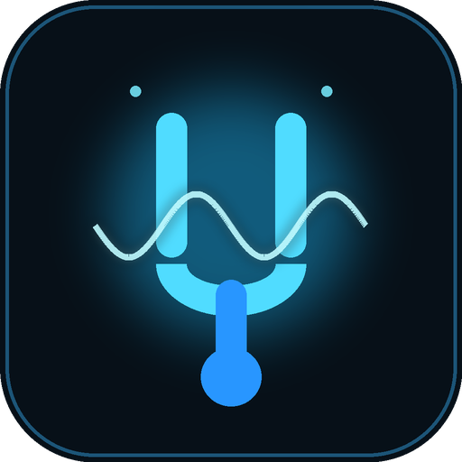
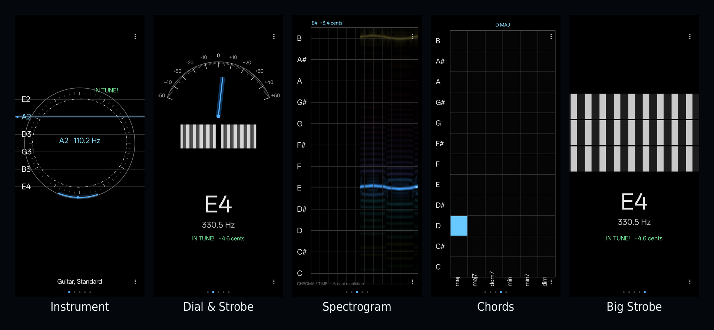
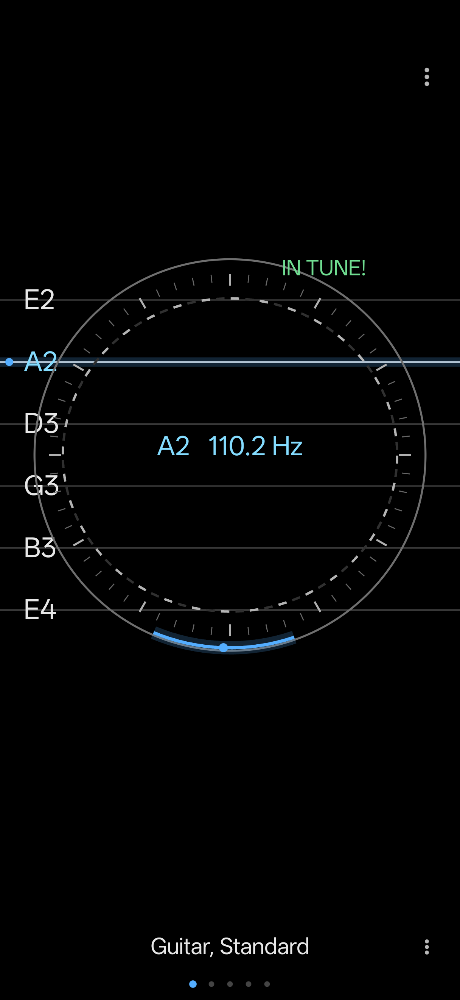
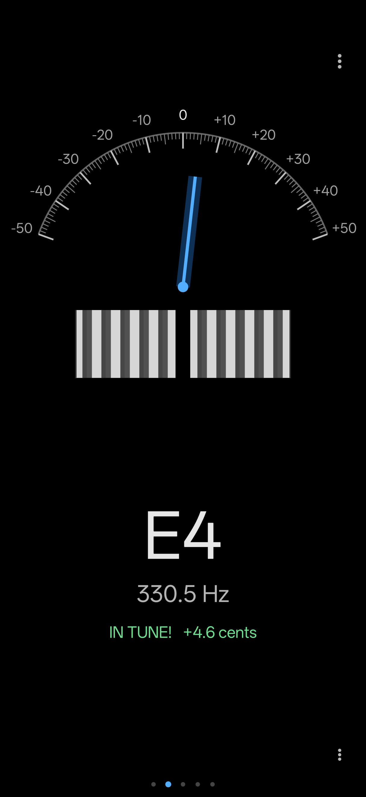
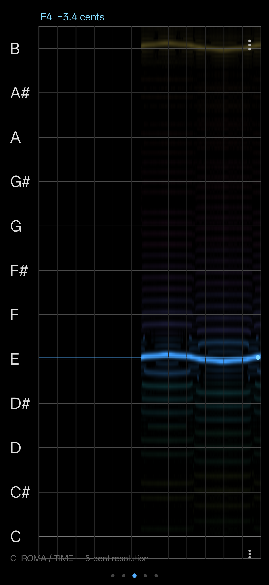
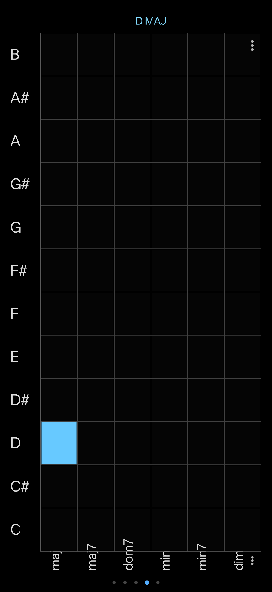
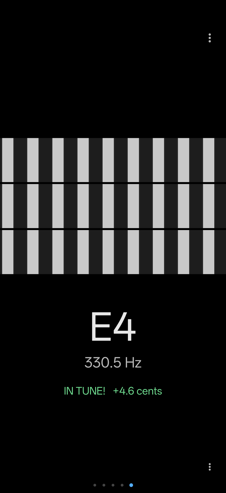
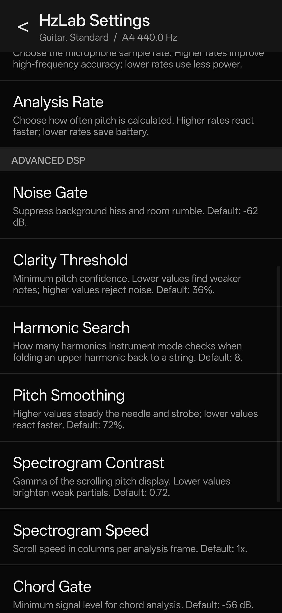

# HzLab

**A modern, clean-room chromatic tuner and pitch visualiser for Android.**

HzLab revives the workflow of the long-abandoned PitchLab Lite tuner for current phones. The original app shipped a 32-bit ARM native engine and cannot be installed on modern 64-bit-only Android devices. HzLab is a new, pure-Java implementation built for today’s hardware: no 32-bit library, no obsolete ad SDK, no network dependency.

[](https://github.com/MohammedAlamkhan/HzLab/releases/latest)
[](https://github.com/MohammedAlamkhan/HzLab/actions/workflows/build.yml)
[](LICENSE)


<p align="center">
  
</p>

## Why HzLab exists

PitchLab Lite was a distinctive tuner: a chromatic strobe, an instrument-aware radial display, a scrolling pitch view and a chord grid in one app. It was abandoned years ago, and its `armeabi` library is unusable on current arm64-only phones. Even ADB cannot install a 32-bit-only APK on those devices.

HzLab keeps the useful musical ideas alive in a form that can be maintained, audited and improved:

- **64-bit ready** — the APK contains no native libraries at all.
- **Offline and private** — microphone audio is analysed locally; there is no network permission, analytics or advertising.
- **Open source** — the complete implementation is here, under the GPL.
- **Modern Android** — target SDK 35, runtime microphone permission, edge-to-edge rendering, 64-bit-only device support.

This is a **clean-room reimplementation**, not a repackaging of the original app. No original source code, native library, artwork, icon, layout or screenshot is included. See [NOTICE](NOTICE).

## Download

Get the latest signed APK from the [GitHub Releases page](https://github.com/MohammedAlamkhan/HzLab/releases/latest).

Direct file for `v1.0.0`:

**[HzLab-1.0.0.apk](https://github.com/MohammedAlamkhan/HzLab/releases/download/v1.0.0/HzLab-1.0.0.apk)**

- Android 6.0 (API 23) or newer
- arm64, armeabi-v7a or x86 — no ABI-specific binaries
- SHA-256 and signing certificate are published with each release

### Install without a computer

1. Download the APK on your phone.
2. Open it from Files and allow “Install unknown apps” for your browser or file manager if prompted.
3. Launch **HzLab** and allow microphone access.
4. Swipe left/right to change view. Tap the three dots or long-press the display for the view menu and settings.

### Install with ADB

```bash
adb install -r HzLab-1.0.0.apk
```

## Screenshots



| Instrument | Dial & Strobe |
|---|---|
|  |  |
| **Spectrogram** | **Chords** |
|  |  |
| **Big Strobe** | **Settings** |
|  |  |

## Features

### Five tuning displays

- **Instrument** — radial strobe, string indicators and a selected-tuning view for guitar, bass, violin, fiddle, mandolin, ukulele, banjo, bouzouki and pedal steel. Upper harmonics are folded back to the intended string so a bright harmonic does not appear as an unrelated high note.
- **Dial & Strobe** — a cent scale with a moving needle and a linear strobe, optimised for hands-free tuning.
- **Spectrogram** — a 240-bin continuous pitch axis (5 cents per bin) with a live cents readout. Vibrato and microtones are visible instead of being flattened into 12 pitch classes.
- **Chords** — a 12 × 6 grid for major, major 7th, dominant 7th, minor, minor 7th and diminished chords. Includes temporal smoothing, root/bass weighting and candidate cells.
- **Big Strobe** — a large single-strobe display for small screens.

### Tuning tools

- All **52 built-in instrument tunings** from the classic tuner, from guitar and bass to bouzouki and pedal steel.
- **17 temperaments** including equal temperament and historical temperaments such as Kirnberger, Meantone, Pythagorean, Valotti and Young.
- **Custom tunings** — up to 100 user-defined instruments with up to 12 strings/notes.
- **Custom temperaments** — 12 editable cent offsets.
- **A4 reference** from 220 to 880 Hz in 0.1 Hz steps.
- **Sharp/flat notation**, 5/10/15-cent in-tune threshold and dynamic/landscape/portrait orientation.
- **Input control** — 44.1, 22.05, 11.025 and 8 kHz sample rates with automatic fallback; low/medium/high analysis rate.
- Settings and custom definitions persist between launches.

## How it works

HzLab deliberately avoids the NDK and third-party runtime dependencies.

```
AudioRecord (mono PCM)
        │
        ▼
  ring buffer ──────────────► PitchDetector
                                  │
                     FFT autocorrelation / NSDF
                     parabolic peak interpolation
                     continuous 240-bin spectral map
                                  │
                                  ▼
                          PitchResult
                                  │
                                  ▼
                    HzLabView (Android Canvas)
```

- **Pitch detection:** normalised square difference function (NSDF) computed through an FFT autocorrelation, with parabolic interpolation of the selected period. This gives sub-cent estimates across the guitar and bass range while remaining cheap enough to run continuously.
- **Harmonic handling:** Instrument mode evaluates the fundamental and its first seven harmonics against the selected strings and folds an upper harmonic back to its string.
- **Spectrogram:** spectral peaks are mapped by interpolated frequency onto a 240-bin axis covering one octave. A separate sub-cent fundamental trace and live cursor make vibrato and microtonal drift legible.
- **Rendering:** all five views are drawn with Android Canvas. No OpenGL context, native renderer or GPU-specific texture paths are required.
- **No ads, no network:** the only permissions are microphone capture and audio-mode adjustment.

## Accuracy and testing

The DSP is tested with synthetic signals in [test/](test/):

```bash
./test/run.sh
```

Covered cases include:

- sine and harmonic-rich signals from 30.87 Hz to 987.77 Hz
- weak or missing fundamentals
- guitar-like plucked-string signals
- sample rates of 44.1, 22.05 and 8 kHz
- chord templates and bass-root detection

Typical synthetic-tone error is below 0.1 cent above 100 Hz. A real phone microphone was also used to capture and inspect live PCM during development. Chord recognition is an estimate, not a polyphonic transcription system; clean, sustained chords work best.

## Build from source

Requirements:

- JDK 21
- Android SDK platform 35 and build-tools 35.0.0
- `JAVA_HOME` and `ANDROID_HOME` (or `ANDROID_SDK_ROOT`) set

```bash
git clone https://github.com/MohammedAlamkhan/HzLab.git
cd HzLab
./build.sh debug      # unsigned debug tooling key, dist/HzLab-1.0.0-debug.apk
./build.sh release    # local release key, dist/HzLab-1.0.0.apk
```

The first build creates a local signing key under `signing/`. That directory is git-ignored; **back it up** if you publish updates. The GitHub Actions workflow builds a debug APK without access to any release key.

The build is intentionally tool-light: `aapt2`, `javac`, `d8`, `zipalign` and `apksigner` from the Android SDK/JDK. No Gradle or Android Studio is required.

Maintainers: see [PUBLISHING.md](PUBLISHING.md) for the release workflow.

## Project layout

```
app/src/main/java/io/github/mohammedalamkhan/hzlab/
  MainActivity.java       lifecycle, microphone permission, view menu
  HzLabView.java          five Canvas visualisers and gestures
  PitchEngine.java        audio thread, analysis loop, string harmonic folding
  PitchDetector.java      FFT/NSDF pitch, chroma and continuous spectrum
  AudioCapture.java       AudioRecord wrapper with sample-rate fallback
  Settings.java           local preferences
  InstrumentLibrary.java  52 instrument tunings
  TemperamentLibrary.java 17 temperament presets
  CustomEditors.java      custom tuning/temperament editors
  OptionsActivity.java    settings UI
test/                     generated-signal DSP tests
docs/                     screenshots and branding
```

## Known limitations

- HzLab is a reimplementation, not a pixel-for-pixel clone. The displays are intentionally cleaner and adapted to modern screens.
- Chord recognition is an estimate and can mislabel dense or distorted chords.
- The app is designed for live acoustic input. Bluetooth microphone latency depends on the device and is not compensated.
- Preset tunings and historical temperament values are factual musical data; no original app assets are used.

## Contributing

Contributions are welcome. Please read [CONTRIBUTING.md](CONTRIBUTING.md). Good places to help:

- test on more arm64-only phones and report device-specific audio behaviour
- improve chord estimation and spectrogram contrast
- accessibility and tablet/landscape layout
- translations and documentation

If you find the project useful, a star helps other musicians find it.

## Privacy

HzLab processes microphone audio in memory on the device. It does not record, save, upload or share audio, and it has no network permission. Read [PRIVACY.md](PRIVACY.md).

## License

HzLab is free software licensed under the **GNU General Public License v3.0 or later**. See [LICENSE](LICENSE).

You can use, study, share and modify HzLab. If you distribute a modified version, it must remain under the same free-software terms.

## Acknowledgements

HzLab was inspired by the workflow of the abandoned **PitchLab Lite** tuner. The original project and its author are not affiliated with HzLab. No original code, native library, icons, artwork, layouts or screenshots are included. Instrument tuning sets and historical temperament values are factual musical data.

Thank you to the musicians and developers who keep useful tools alive.
